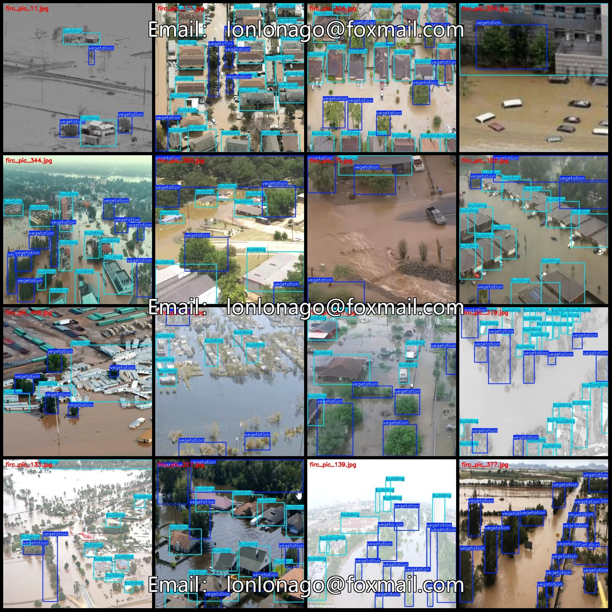
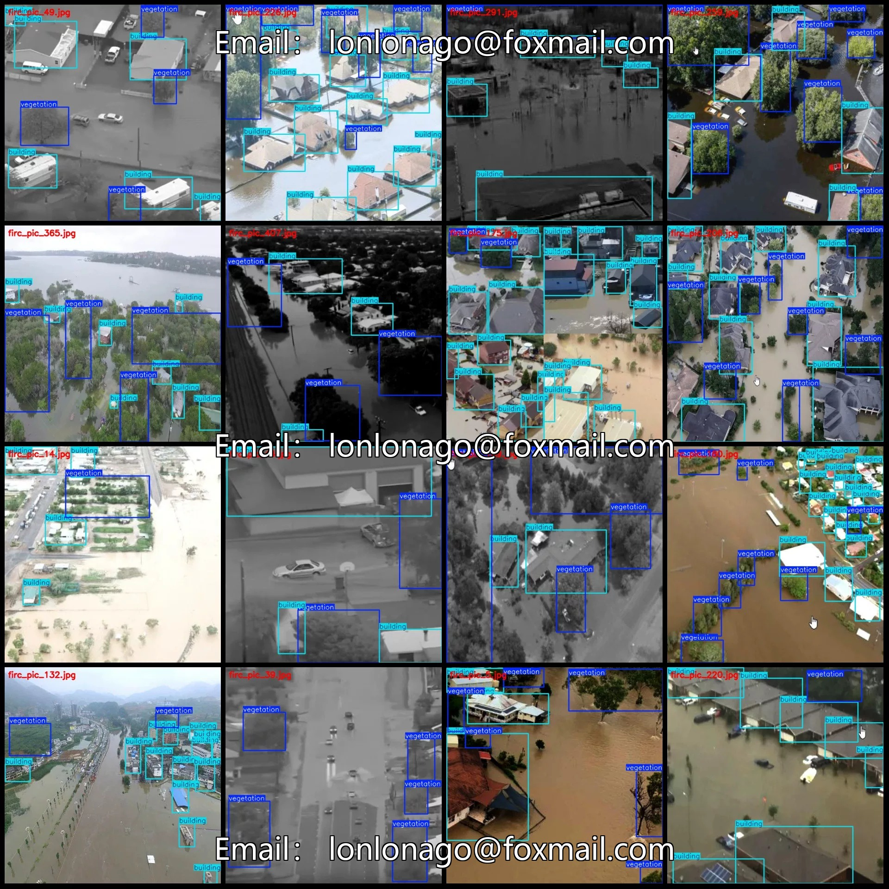
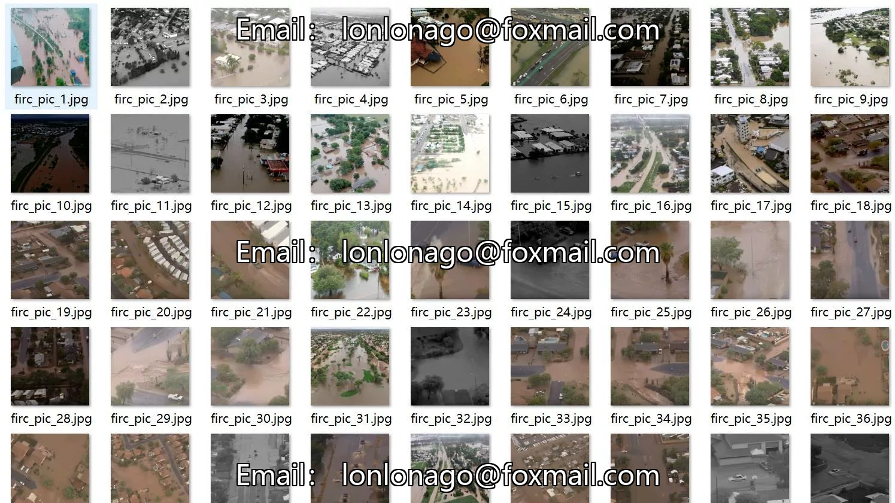
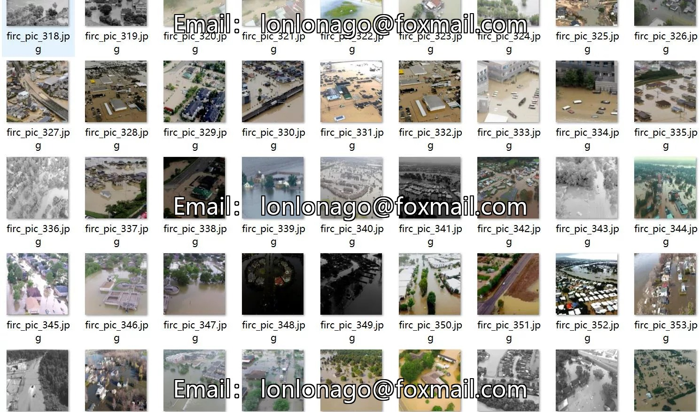
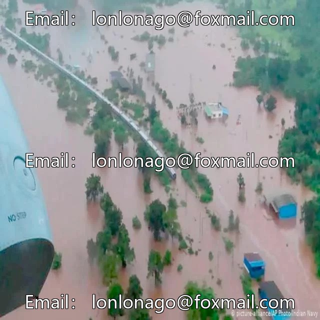
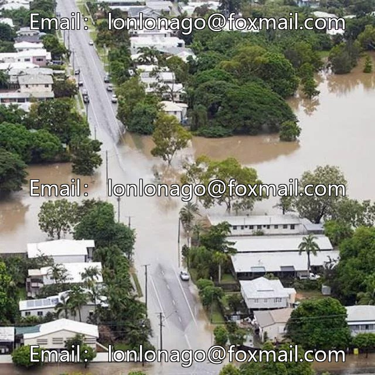
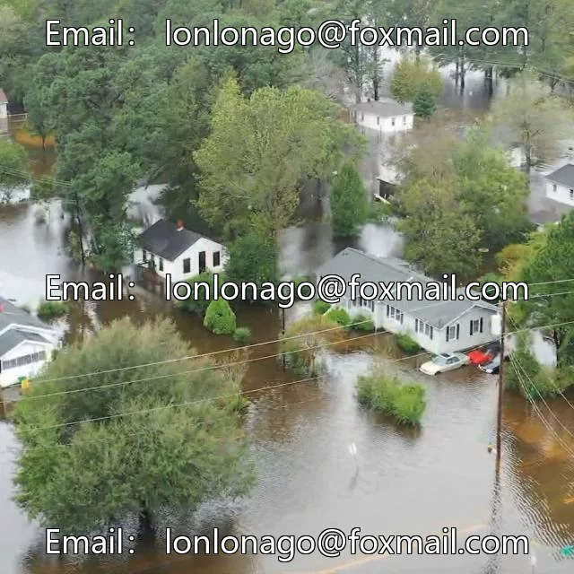

# Drone-view aerial photography flood disaster building vegetation detection dataset VOC+YOLO format

## Body

Drone-view aerial photography flood disaster building vegetation detection dataset VOC+YOLO format 417 images 2 categories
Tips: Due to the dataset's replicability, please confirm compliance before purchasing.
Dataset format: Pascal VOC format + YOLO format (txt file without split path, only containing jpg images and corresponding VOC format xml files and yolo format txt files)
Number of images (number of jpg files): 417
Number of annotations (number of xml files): 417
Number of annotations (number of txt files): 417
Number of annotation categories: 2

Label categories (note that the order of labels in YOLO format does not correspond to this, but is based on the classes.txt file in the labels folder): ["building", "vegetation"]
Number of bounding boxes and images per category:
- Building (Building) = 4017, occupied by 394 images
- Vegetation (Vegetation) = 1989, occupied by 393 images
Total number of bounding boxes: 6006
Image resolution: 640x640
Labeling tool used: labelImg
Labeling rules: Draw a rectangle around the category
Important note: The dataset does not have separate training, validation, or test sets; you will need to manually divide them.

Special : This dataset does not guarantee the accuracy of the trained models or weight files.

## Images

## Payment

Here is a pay link on Stripe ( https://buy.stripe.com/3cs8yP7sY87d0vu9AB ). Please contact me lonlonago@foxmail.com after funding $89, and I will send you a complete data files , thank you!

